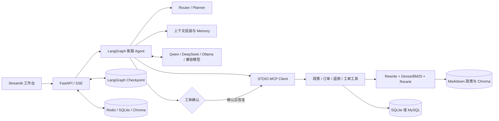

# OrderCare-Agent

面向电商售后场景的智能客服 Agent 示例项目。项目将政策检索、订单与退款业务工具、工单人工确认和多轮对话编排到同一条可恢复的客服流程中，并提供工作台、服务 API 与离线评测数据。

> 商城政策、订单和工单均为演示数据。退款工具只判断资格，不执行真实退款；项目尚未实现正式账户认证与线上支付。

## 功能概览

| 能力 | 实现 |
| --- | --- |
| Agent 编排 | LangChain Tool Calling 与 LangGraph 状态流转、Checkpoint、中断和恢复 |
| 意图与任务规划 | Pydantic Router 识别政策、订单、退款、维修、工单等请求；复合任务按依赖与条件执行 |
| 业务工具 | 通过本地 STDIO MCP 暴露政策检索、订单查询、退款资格和工单创建 |
| 工单审批 | 写入前请求用户确认；确认后恢复执行，结合签名与幂等校验避免重复建单 |
| 政策 RAG | 36 份规范化售后政策；Dense 与 BM25 混合召回、Query Rewrite 和本地 BGE Cross-Encoder 重排，返回带来源的证据 |
| 调用韧性 | 政策检索入口提供成功结果 TTL 缓存、超时、熔断和明确降级；MCP 层保护传输与业务只读调用 |
| Memory 与上下文 | Redis 会话工作记忆、Chroma 情景记忆、SQLite 用户画像；模型调用前按 Token Budget 组装上下文并裁剪低优先级历史 |
| 服务与界面 | FastAPI、SSE、Streamlit 客服工作台，支持会话隔离、历史会话和审批交互 |

## 架构



客服 Agent 使用真实配置的模型运行，不提供运行时假模型回退。`create_agent` 管理模型和工具循环，LangGraph 中间件负责路由、任务执行限制、上下文和人工审批。详细模块说明见 [Agent 执行链](docs/architecture/agent-execution-flow.md)、[Router / Planner](docs/architecture/router-planner.md) 与 [MCP 工具](docs/mcp-business-tools.md)。

## 快速开始（Windows + Ollama）

需要 Python 3.12、[uv](https://docs.astral.sh/uv/)、Ollama 和 Redis。Redis 可使用本机服务；若本机没有 Redis 且 Docker Desktop 可用，演示启动脚本会尝试启动 Compose 中的 Redis。

```powershell
git clone https://github.com/Snape001/OrderCare-Agent.git
cd OrderCare-Agent
ollama pull qwen3:4b
if (!(Test-Path .env)) { Copy-Item .env.ollama.example .env }
.\scripts\setup_demo.cmd
.\scripts\start_demo.cmd
```

首次安装会同步依赖、准备演示订单并构建政策索引；首次使用还需下载中文 Embedding 和本地 reranker 权重（约 1.1 GB）。服务运行后另开终端启动工作台：

```powershell
uv run streamlit run src/streamlit_app.py --server.address 127.0.0.1 --server.port 8501
```

- 客服工作台：<http://127.0.0.1:8501>
- API 文档：<http://127.0.0.1:8080/docs>
- 健康 / 就绪检查：<http://127.0.0.1:8080/health>、<http://127.0.0.1:8080/ready>

停止演示服务：`.\scripts\stop_demo.cmd`。Linux/macOS 可使用同一组 `uv` 命令；环境变量和启动参数请参考 `.env.ollama.example` 与脚本说明。

## 模型配置

在本地 `.env` 选择 Provider 并填写自己的凭据。密钥不要提交到 Git。

| Provider | 配置示例 | 必要设置 |
| --- | --- | --- |
| Ollama | [.env.ollama.example](.env.ollama.example) | `OLLAMA_MODEL`、`OLLAMA_BASE_URL` |
| DeepSeek | [.env.deepseek.example](.env.deepseek.example) | `DEEPSEEK_API_KEY`、`DEEPSEEK_MODEL` |
| Qwen | [.env.qwen.example](.env.qwen.example) | DashScope API Key 与模型配置 |
| 通用兼容模型 | [.env.example](.env.example) | `DEFAULT_MODEL` 与对应 Provider 凭据 |

默认政策 Query Rewrite 需要 `DEEPSEEK_API_KEY`；未配置或改写失败时会回退原始 Query，继续本地检索。改写 API 的调用与费用由所选配置决定。配置说明见 [DeepSeek Provider](docs/deepseek-provider.md) 和 [.env.example](.env.example)。

## 演示对话

本地样例订单可用手机号后四位 `8821`：

```text
七天无理由退款有什么要求？请标注政策来源。
查询订单 ORD1001，手机号后四位 8821
订单 ORD1002 能退款吗？手机号后四位 8821
为 ORD1001 创建人工客服工单，手机号后四位 8821
确认
```

样例数据只用于演示：`ORD1001` 为运输中订单，`ORD1002` 满足配置的演示退款条件。创建工单会先暂停并请求确认。

## RAG 与 Agent 评测

仓库保留版本化数据集及逐题结果，离线实验不会自动更改线上检索配置。当前 RAG v5 使用 50 道标注题比较 Dense、Hybrid 和 Rewrite + Rerank Hybrid；在挑战集上的 Recall@3 分别为 **0.84、0.90、0.96**。该数据集包含按口语失配设计的挑战题，结果用于方案对比，不代表无偏线上效果。详见 [RAG v5 实验](docs/evaluation/rag-v5.md) 与 [评测数据目录](data/evaluation/rag/)。

另外，项目包含 20 道客服 Agent 端到端用例，覆盖政策问答、订单查询、退款、条件任务和工单确认。真实运行记录使用隔离数据库；人工修正评分标准后的报告为 20/20，修正前记录与限制见[端到端评测说明](docs/evaluation/agent-e2e-v1.md)。其中一次运行不是当前代码每次都能达到的保证，也不应解读为线上成功率。

运行离线 RAG 评测需使用项目对应的政策版本、索引和数据集：

```powershell
uv run python scripts/evaluate_rag.py
uv run python scripts/evaluate_three_way_rag.py --help
```

三方案脚本支持版本化语料、数据集和输出目录；涉及 DeepSeek Rewrite 的实验须显式启用付费 API 参数。运行参数和复现边界以各版本报告及脚本 `--help` 为准。自动化测试：

```powershell
uv run pytest -q
```

## 配置与部署补充

- Docker Compose + MySQL 路径需要额外准备 Olist 数据集，步骤见 [数据说明](docs/data/olist-dataset.md) 和 [Docker 部署说明](docs/deployment/docker-mysql.md)。
- 上下文预算、Redis Memory、政策检索超时/缓存/熔断及 MCP 传输保护均可通过环境变量配置，默认值见 [`.env.example`](.env.example)。
- 原始数据、业务数据库、向量索引、模型缓存和本地 `.env` 不应提交。政策与评测数据的版本约束见 [政策版本记录](data/policies/VERSIONS.md)。

## 项目结构

```text
src/agents/                 Agent 图、工具循环与中间件
src/customer_support/       售后业务工具、MCP、政策检索
src/memory/                 分层 Memory、上下文管理与压缩
src/service/                FastAPI、会话和工作台服务
src/evaluation/             RAG 与 Agent 评测实现
data/policies/              版本化 Markdown 政策语料
data/evaluation/             标注数据集、运行结果与报告
docs/architecture/          架构设计
scripts/                    初始化、索引、评测和部署脚本
tests/                       单元与集成测试
```

## 当前边界

这是用于学习和演示的电商售后项目。手机号后四位不是正式身份认证；不执行真实退款；SQLite Checkpoint 适用于单机演示；Memory、MCP 和模型服务的生产部署仍需结合实际环境进行权限、并发和可用性治理。政策内容为模拟规则。
