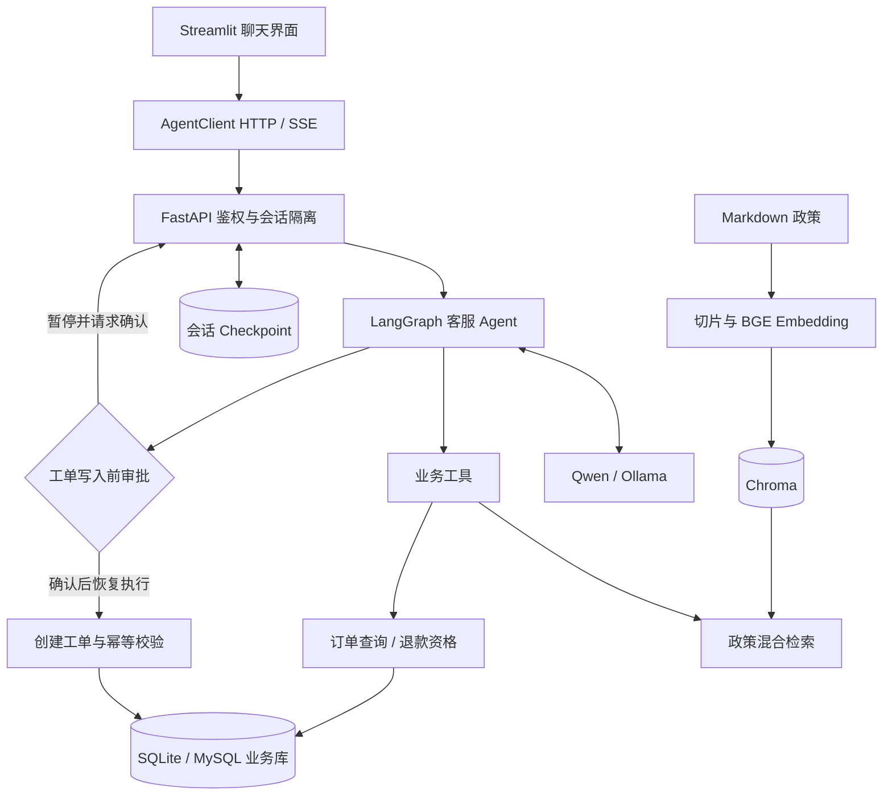

# OrderCare-Agent

面向电商售后场景的智能客服 Agent，使用 **LangChain / LangGraph + Function Calling + RAG + Human-in-the-Loop**，完成「查政策 → 查订单 → 判断退款资格 → 用户确认 → 创建工单」业务闭环。

本项目作为 Agent 开发实习作品，重点展示模型与业务工具的协作、检索质量评测、可恢复的人工审批，以及从聊天界面到数据库的工程实现。商城政策与工单流程用于演示；退款工具只判断资格，不执行支付退款。

## 核心功能

| 功能 | 实现方式 | 业务约束 |
| --- | --- | --- |
| 政策问答 | `search_policy` 检索退款、物流、发票、保修等政策 | 返回来源文件、章节与引用；低相关结果拒答 |
| 订单与物流查询 | `get_order_status` 查询 SQLite / MySQL | 校验订单号与演示手机号后四位 |
| 退款资格判断 | `check_refund_eligibility` 执行业务规则 | 结合签收时间与商品状态，缺少必要信息时转人工 |
| 人工工单 | `create_support_ticket` 写入业务库 | 写入前暂停审批，明确确认后恢复；幂等键避免相同请求重复建单 |
| 多轮对话 | LangGraph Checkpoint 保存消息和中断状态 | 服务端结合会话凭证、Agent ID 和 thread ID 隔离会话 |
| 交互与部署 | Streamlit 聊天、FastAPI API、SSE、Docker Compose | 提供健康检查、只读数据库浏览入口与验证脚本 |

## Agent 技术设计

### 1. 模型决策与工具执行

真实客服通过 `create_agent` 构建图，由框架完成「模型生成结构化 tool calls → 工具执行 → ToolMessage 回传 → 模型继续决策或回答」循环。四个业务工具提供明确参数契约，订单事实与退款判断由工具返回，避免仅靠 Prompt 生成业务结论。

Qwen 模式对意图和必需参数均明确的请求使用确定性工具路由；模糊请求交给模型。Ollama 模式由模型自主选择工具。Mock 模式使用单节点规则图，便于无 API Key 演示和回归验证，不代表真实模型推理效果。

### 2. 政策 RAG 与证据引用

- 按 Markdown 二级标题解析政策，默认按 220 字符切片、重叠 40 字符，保留标题、来源和切片 ID。
- 使用 FastEmbed 加载 `BAAI/bge-small-zh-v1.5` 中文向量模型，Chroma 持久化索引；源文与配置指纹变化时重建。
- 对比 `lexical`、`dense`、`hybrid` 三种检索。词法召回使用中文二元字组与英文数字 token 重叠；混合检索采用自定义加权倒数排名融合，并设置相关性阈值。
- 工具输出证据与引用；真实模型负责组织答案。当前没有独立 reranker、Query Rewrite 或生成答案事实一致性评分。

### 3. 人工审批、状态恢复与幂等

`HumanInTheLoopMiddleware` 在创建工单工具执行前中断。服务端持久化检查点，下一轮将明确确认转换为 `Command(resume=...)` 的批准决策，其他答复按拒绝处理。工具执行时再次校验订单信息，并根据订单、类别、摘要生成幂等键。

会话 Checkpoint 与业务订单库分开：前者保存消息和审批状态，后者保存订单与工单。默认长期 Store 是进程内存，不是持久化用户记忆系统。

### 4. 可观测性与评测

模型和工具中间件记录调用耗时、工具名称、状态与异常类型；pytest 覆盖业务规则、Agent 行为、会话访问控制、客户端与服务接口。评测脚本分别衡量检索质量与确定性业务行为，在线模型链路另有验证入口。

## 技术栈

| 层次 | 技术 | 用途 |
| --- | --- | --- |
| 语言与依赖 | Python 3.12–3.14、uv、`uv.lock` | 环境隔离与锁定依赖；推荐 Python 3.12 |
| Agent 编排 | LangChain、LangGraph | Tool Calling、中间件、检查点与中断恢复 |
| 模型 | Qwen（OpenAI-compatible API）、Ollama | 云端与本地真实模型；另提供 Mock 模式 |
| 检索 | FastEmbed、BGE 中文 Embedding、Chroma | 政策向量化、持久化与混合召回 |
| 服务与界面 | FastAPI、Pydantic、Uvicorn、HTTPX、Streamlit | 输入校验、HTTP/SSE、聊天界面 |
| 数据 | SQLite、MySQL、PyMySQL | 本地演示、关系型业务数据及工单存储 |
| 工程 | Docker Compose、pytest、Ruff | 部署编排、回归测试、代码检查 |

具体依赖版本以 [pyproject.toml](pyproject.toml) 和 [uv.lock](uv.lock) 为准。仓库还保留研究、MCP、Supervisor、语音等扩展示例，它们不属于默认客服主链路。

## 系统架构



真实图由 `create_agent` 生成；Mock 图在规则节点内执行流程。SSE 是服务传输协议：Ollama 客服当前在图完成或审批暂停后发送最终内容，并非逐 token 输出。

## 安装与运行

### 方式一：本地 Mock 演示（推荐首次运行）

需要 Git、Python 3.12 和 uv。Windows 可用 `winget install --id astral-sh.uv -e` 安装 uv，安装后重新打开终端。

```powershell
git clone https://github.com/Snape001/OrderCare-Agent.git
cd OrderCare-Agent
.\scripts\setup_demo.cmd
.\scripts\start_demo.cmd
```

安装脚本安装依赖、在 `.env` 不存在时复制 Mock 配置、初始化模拟订单、构建并评测 RAG 索引、运行客服测试。已有 `.env` 会被保留；如需 Mock 模式，请检查其中 `CUSTOMER_SUPPORT_MODE=mock`、`USE_FAKE_MODEL=true`、`DEFAULT_MODEL=fake`，并使用 SQLite 业务库。

首次需联网下载依赖和约 90 MB 的 Embedding 模型；缓存完成后，Mock 演示无需云端模型 API Key。停止服务执行 `.\scripts\stop_demo.cmd`。

也可以在项目根目录手动运行（以下为 PowerShell）：

```powershell
uv python install 3.12
uv sync --frozen --python 3.12
# 仅在尚未创建 .env 时复制
if (!(Test-Path .env)) { Copy-Item .env.mock.example .env }
$env:PYTHONPATH = "src"
uv run python -c "from customer_support.store import initialize_database; initialize_database()"
uv run python scripts/evaluate_rag.py
uv run python src/run_service.py
```

另开一个项目目录终端启动界面：

```powershell
uv run streamlit run src/streamlit_app.py --server.address 127.0.0.1 --server.port 8501
```

Linux/macOS 使用相同的 `uv` 命令，复制配置使用 `cp .env.mock.example .env`（仅首次），设置路径使用 `export PYTHONPATH=src`。

| 入口 | 地址 |
| --- | --- |
| 聊天界面 | http://127.0.0.1:8501 |
| API 文档 | http://127.0.0.1:8080/docs |
| 存活 / 就绪检查 | http://127.0.0.1:8080/health / http://127.0.0.1:8080/ready |

### 方式二：真实 Qwen / Ollama Agent

保留本地配置，在 `.env` 中按 [.env.qwen.example](.env.qwen.example) 填入自己的百炼 API Key、业务空间兼容地址和可用模型 ID。建议显式设置 `CUSTOMER_SUPPORT_MODE=qwen`，配置不完整时会启动失败，便于发现问题。`auto` 则在 Qwen 配置不完整时回退 Mock。

```dotenv
CUSTOMER_SUPPORT_MODE=qwen
DASHSCOPE_API_KEY=replace-with-your-own-key
DASHSCOPE_BASE_URL=https://your-workspace.cn-beijing.maas.aliyuncs.com/compatible-mode/v1
DASHSCOPE_MODEL=replace-with-your-available-model-id
USE_FAKE_MODEL=true
DEFAULT_MODEL=fake
```

这里的 Fake 配置供其他演示 Agent 使用；客服模型由 `CUSTOMER_SUPPORT_MODE` 单独选择。修改后重启服务，运行 `uv run python scripts/check_qwen_connection.py` 和 `uv run python scripts/check_qwen_tool_call.py` 检查连接与工具调用；这些操作会调用云端 API。

本地模型可参考 [.env.ollama.example](.env.ollama.example)，先安装并启动 Ollama，再运行：

```powershell
ollama pull qwen3:4b
```

将 `.env` 中的 `CUSTOMER_SUPPORT_MODE` 改为 `ollama`，并设置 `OLLAMA_MODEL=qwen3:4b`、`OLLAMA_BASE_URL=http://127.0.0.1:11434`，重启服务。本地推理速度取决于硬件配置。

### 方式三：Docker Compose + MySQL

这一路径依赖 Olist 数据文件，**新克隆的仓库不能直接跳过数据准备启动完整 Compose**。

1. 安装并启动 Docker Desktop，先完成上面的依赖安装和 `.env` 配置。
2. 按 [数据说明](docs/data/olist-dataset.md) 获取 Olist 原始 CSV，解压到 `data/raw/olist/`。
3. 运行 `uv run python scripts/import_olist.py`，生成 `data/olist_support.db`。
4. 参考 [.env.docker.example](.env.docker.example) 配置本地 `.env`，尤其是 MySQL 参数；启用数据库浏览需设置独立的 `DATABASE_ADMIN_SECRET`。
5. 启动并检查：

```powershell
docker compose up --build -d
docker compose ps
.\scripts\verify_docker.cmd
```

Compose 编排 MySQL、数据迁移任务、Agent API、聊天界面和只读数据库浏览器（http://127.0.0.1:8081）。业务数据写入 MySQL，Checkpoint 使用独立 SQLite；健康检查和迁移完成条件控制启动顺序。日常停止使用 `docker compose down` 保留数据卷。

原始数据、导入数据库、向量索引、模型缓存和本地密钥均不随 Git 提交。Olist 演示后四位由匿名 ID 派生，不是真实手机号；缺少拆封状态的订单不会被模型擅自判定可退款。更多内容见 [部署说明](docs/deployment/docker-mysql.md)。

## 演示流程

本地 Mock 数据使用后四位 `8821`，可依次输入：

```text
七天无理由退款有什么要求？请标注政策来源。
查询订单 ORD1001，手机号后四位 8821
订单 ORD1002 能退款吗？手机号后四位 8821
订单 ORD1003 能退款吗？手机号后四位 8821
为 ORD1001 创建人工客服工单，手机号后四位 8821
确认
```

预期：政策回答附来源；`ORD1001` 为运输中；`ORD1002` 满足演示退款条件；`ORD1003` 被拒绝；工单在确认后才写入。也可以重新发起工单请求并回复“取消”验证拒绝分支。

## 测试与评测

```powershell
uv run pytest tests/customer_support tests/service tests/agents -q
uv run python scripts/evaluate_agent.py
uv run python scripts/evaluate_rag.py
```

运行中的 Mock HTTP 主流程可用 `.\scripts\run_tests.cmd` 验收。在线 Qwen/Ollama 验证需要对应服务，相关测试与脚本不能等同于离线回归。

仓库已有 [RAG 报告](data/evaluation/rag_report.json) 使用 64 条正例与 8 条越界问题，比较 Hit@1、Hit@3、MRR@3、越界拒答率及 P95 检索延迟。[Agent 报告](data/evaluation/agent_report.json) 记录 34 项确定性检查，覆盖路由、业务规则、身份校验和幂等。它们是小规模本地实验快照，不代表生产效果或真实 LLM 端到端成功率；复现实验应重新运行脚本并检查逐题错误。

## 项目结构与源码导航

```text
src/
  agents/customer_support_agent.py   # 真实客服图、工具路由、审批中间件
  agents/customer_support_mock.py    # 确定性 Mock 图
  customer_support/                 # 工具、RAG、政策、SQLite/MySQL 数据访问
  service/                          # API、会话隔离、输出展示过滤
  client/                           # HTTP / SSE 客户端
  memory/                           # Checkpoint / Store 适配
  core/                             # 配置与通用模型工厂
  schema/                           # 请求、响应与消息模型
  streamlit_app.py                  # 聊天入口
data/policies/                     # 政策知识源
data/evaluation/                   # 标注用例与实验报告
scripts/                           # 初始化、部署、数据导入与评测
tests/                             # 自动化测试
docs/architecture/                 # 架构与模块说明
docs/learning/                     # 调试记录与开发复盘
docker/                            # 容器构建文件
```

- [项目总览](docs/architecture/project-overview.md) · [Agent 执行链](docs/architecture/agent-execution-flow.md)
- [状态与记忆](docs/architecture/state-and-memory.md) · [RAG 架构](docs/architecture/rag-architecture.md)
- [模块索引](docs/architecture/module-reference.md) · [入门操作](START_HERE.md)
- [政策意图误路由复盘](docs/learning/bug-001-order-policy-routing.md) · [Qwen 事件处理复盘](docs/learning/bug-002-qwen-agent-event-handling.md)

## 当前边界与后续方向

当前是可运行的实习演示项目：手机号后四位仅用于演示校验，会话凭证不等同于账户登录；默认长期记忆为进程内存，SQLite Checkpoint 面向单机。默认客服未实现多 Agent 协作、独立规划器或真实退款支付。部署到公网前需补充正式身份认证、权限模型和运行治理。

后续可围绕独立测试集与真实模型端到端评测、检索重排、生成答案证据一致性、结构化错误处理、持久化长期记忆与并发性能开展迭代。
