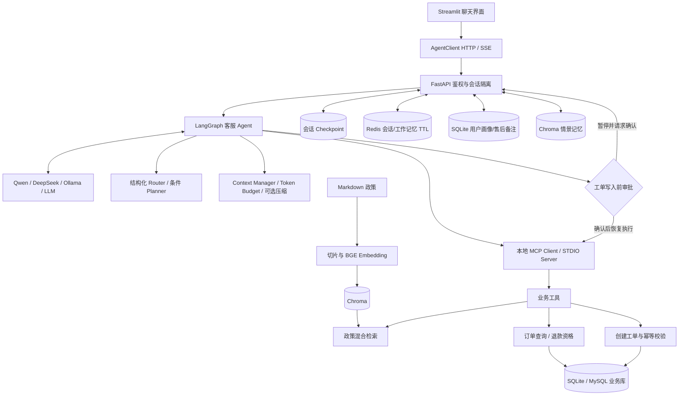

# OrderCare-Agent

面向电商售后场景的智能客服 Agent，使用 **LangChain / LangGraph + Function Calling + RAG + Human-in-the-Loop**，完成「查政策 → 查订单 → 判断退款资格 → 用户确认 → 创建工单」业务闭环。

本项目重点展示模型与业务工具的协作、检索质量评测、可恢复的人工审批，以及从聊天界面到数据库的工程实现。商城政策与工单流程用于演示；退款工具只判断资格，不执行支付退款。

## 核心功能

| 功能 | 实现方式 | 业务约束 |
| --- | --- | --- |
| 政策问答 | `search_policy` 检索退款、物流、发票、保修等政策 | 返回来源文件、章节与引用；低相关结果拒答 |
| 订单与物流查询 | `get_order_status` 查询 SQLite / MySQL | 校验订单号与演示手机号后四位 |
| 退款资格判断 | `check_refund_eligibility` 执行业务规则 | 结合签收时间与商品状态，缺少必要信息时转人工 |
| 人工工单 | `create_support_ticket` 写入业务库 | 写入前暂停审批，明确确认后恢复；幂等键避免相同请求重复建单 |
| 多轮对话 | LangGraph Checkpoint 保存消息和中断状态 | 服务端结合会话凭证、Agent ID 和 thread ID 隔离会话 |
| 分层 Memory | Redis 工作状态与 TTL、Chroma+BGE 历史事件、SQLite 结构化用户画像 | 正常启动自动启用；跨会话读取须先验证订单身份；摘要替代历史默认关闭 |
| 交互与部署 | Streamlit 聊天、FastAPI API、SSE、Docker Compose | 提供健康检查、只读数据库浏览入口与验证脚本 |

### Streamlit 客服工作台

左侧提供「客服工作台、知识库管理、执行记录」三个页面入口，以及不跳转页面的「隐私说明」弹窗。浅色工作台以对话为中心，支持多轮会话、历史会话、新建会话、快捷提问、SSE 请求、思考计时、取消请求和工单人工确认。执行轨迹不在聊天区展示；如需排查请求，可到「执行记录」查看服务端保存的脱敏事件。

知识库管理页展示政策文档和索引信息，提供独立的 RAG 检索调试。Direct 与 Hybrid 使用当前知识库；Rewrite + Hybrid 仅在手动选择后调用所配置的模型。前端不提供 Provider、API Key 或环境变量修改入口，这些设置通过本地 `.env` 管理。

工作台使用 `/workbench/status`、`/workbench/policies`、`/workbench/search`、`/workbench/traces` 与 `/workbench/sessions/{thread_id}`；接口复用服务端的 Bearer 验证与会话凭证。Trace 仅存储筛选、脱敏后的字段，不保存原始模型思考内容。当前客服前端在收到完整安全回答后渲染，SSE 传输和等待计时仍有效；逐 token 的客服正文显示尚未开放，以避免未完成的思考片段或工具消息进入页面。

## Agent 技术设计

### 1. 模型决策与工具执行

真实客服通过 `create_agent` 构建图，由框架完成「模型生成结构化 tool calls → 工具执行 → ToolMessage 回传 → 模型继续决策或回答」循环。四个业务工具提供明确参数契约，订单事实与退款判断由工具返回，避免仅靠 Prompt 生成业务结论。

Qwen 模式对意图和必需参数均明确的请求使用确定性工具路由；模糊请求交给模型。Ollama、DeepSeek 和通用 LLM 模式由模型自主选择工具。运行时只使用真实模型：配置错误直接报错，调用失败向客户端返回明确错误，不自动切换 Provider。测试中注入的假模型仅用于隔离外部服务。

客服图还用当前 Provider 的结构化输出执行 Router：识别普通对话、政策、订单、退款资格、维修和工单等意图，并从用户原文校验实体。单意图生成简单任务；多意图或条件请求才进入 Planner，输出至多六步的顺序、依赖和退款条件分支。生产校验限制可规划动作，防止模型自行增加工单等敏感操作；每一步只开放当前所需工具。详见 [Router / Planner 架构](docs/architecture/router-planner.md)。这不是通用 DAG 引擎，真实模型任务完成率尚无充分基准。

四个业务工具通过本地 Python MCP SDK 的 STDIO Server 暴露，由 `langchain-mcp-adapters` 发现并交给客服图。MCP 层委托原业务函数，工单仍由图内人工审批中断和 Server 端内部签名共同保护；连接失败不绕过 MCP。协议、参数 Schema 与验证见 [MCP 业务工具](docs/mcp-business-tools.md)。

### 2. 政策 RAG 与证据引用

- 按 Markdown 二级标题解析政策，默认按 220 字符切片、重叠 40 字符，保留标题、来源和切片 ID。
- 使用 FastEmbed 加载 `BAAI/bge-small-zh-v1.5` 中文向量模型，Chroma 持久化索引；源文与配置指纹变化时重建。
- 对比 `lexical`、`dense`、`hybrid` 三种检索。词法召回使用中文二元字组与英文数字 token 重叠；混合检索采用自定义加权倒数排名融合，并设置相关性阈值。
- 工具输出证据与引用；真实模型负责组织答案。线上默认检索不启用 Query Rewrite，也没有独立 reranker；Rewrite 仅在独立实验和知识库调试中显式调用。生成质量评测与线上事实校验应区分。

### 3. 人工审批、状态恢复与幂等

`HumanInTheLoopMiddleware` 在创建工单工具执行前中断。服务端持久化检查点，下一轮将明确确认转换为 `Command(resume=...)` 的批准决策，其他答复按拒绝处理。工具执行时再次校验订单信息，并根据订单、类别、摘要生成幂等键。

会话 Checkpoint 与业务订单库分开：前者保存消息和审批状态，后者保存订单与工单。框架默认 Store 仍是进程内存；下述三层 Memory 在正常客服服务启动时自动初始化。

正常启动自动启用的 [分层 Memory](docs/architecture/layered-memory.md) 在 Redis 保存带 TTL 的会话摘要、当前订单标识和任务进度；在独立 Chroma Collection 用同进程复用的 BGE Embedding 检索已完成的售后事件；在 SQLite `customer_profiles` 保存结构化沟通偏好，原 `customer_memories` 表保存简短售后备注。跨会话读取必须通过业务订单身份校验取得 `customer_id`，不能把历史订单状态当作实时事实。它不替换 LangGraph SQLite Checkpoint。`MEMORY_ENABLED=true` 和 `EPISODIC_MEMORY_ENABLED=true` 是默认运行配置；Redis 或 Chroma/BGE 初始化失败会阻止服务就绪。只有显式设置 `MEMORY_ENABLED=false` 才关闭三层 Memory。

Context Manager 在模型调用前按任务组装系统规则、工作状态、相关记忆、最近对话和本轮工具证据，并按可配置 Token Budget 淘汰低价值历史。它只改变模型输入视图，不裁剪 Checkpoint；当前请求、审批状态和本轮工具调用配对优先保留。配置与边界见上方架构文档。

当原始上下文达到预算阈值时，[Automatic Context Compaction](docs/architecture/layered-memory.md#automatic-context-compaction) 从较早轮次增量摘录结构化事实，用原子游标存入带 TTL 的 Redis 键。设置 `CONTEXT_COMPACTION_ENABLED=true` 后，摘要才在模型视图中**替代**游标覆盖的旧消息；最近两轮、工具调用配对和审批状态保留，预算或游标异常时回退动态裁剪。默认关闭该替代策略。摘录式压缩不调用模型；曾对固定合成样本单独做有限的 DeepSeek 摘要实验，不属于当前线上摘要器。具体边界见 [Memory 评测](docs/evaluation/memory-evaluation.md)。

### 4. 可观测性与评测

模型和工具中间件记录调用耗时、工具名称、状态与异常类型；pytest 覆盖业务规则、Agent 行为、会话访问控制、客户端与服务接口。评测脚本分别衡量检索质量与确定性业务行为，在线模型链路另有验证入口。

## 技术栈

| 层次 | 技术 | 用途 |
| --- | --- | --- |
| 语言与依赖 | Python 3.12–3.14、uv、`uv.lock` | 环境隔离与锁定依赖；推荐 Python 3.12 |
| Agent 编排 | LangChain、LangGraph | Tool Calling、中间件、检查点与中断恢复 |
| 模型 | Qwen、DeepSeek、Ollama、其他已配置的 LLM Provider | 云端与本地真实模型；不提供模拟客服运行入口 |
| 检索与情景记忆 | FastEmbed、BGE 中文 Embedding、Chroma | 政策向量化与混合召回；独立 Collection 保存客户历史事件 |
| 分层记忆 | Redis、SQLite、LangGraph Checkpoint | 带 TTL 的短期工作状态、结构化画像、完整图状态与审批恢复，各自职责分离 |
| 工具协议 | Python MCP SDK、langchain-mcp-adapters | 本地 STDIO 发现和调用四个原有业务工具 |
| 服务与界面 | FastAPI、Pydantic、Uvicorn、HTTPX、Streamlit | 输入校验、HTTP/SSE、聊天界面 |
| 数据 | SQLite、MySQL、PyMySQL | 本地演示、关系型业务数据及工单存储 |
| 工程 | Docker Compose、pytest、Ruff | 部署编排、回归测试、代码检查 |

具体依赖版本以 [pyproject.toml](pyproject.toml) 和 [uv.lock](uv.lock) 为准。客服主链路通过本地 MCP 调用业务工具；仓库还保留研究、Supervisor、语音等扩展示例。

## 系统架构



客服图统一由 `create_agent` 生成。SSE 是服务传输协议：Ollama 客服当前在图完成或审批暂停后发送最终内容，并非逐 token 输出。

## 安装与运行

### 方式一：Ollama 本地模型

需要 Git、Python 3.12、uv、已运行的 Ollama，以及 Redis。Windows 可用 `winget install --id astral-sh.uv -e` 安装 uv，安装后重新打开终端。`start_demo.cmd` 会连接已有 Redis；若本机未运行 Redis 且 Docker Desktop 可用，会自动执行 `docker compose up -d redis`。两者都不可用时会明确报错，不会静默关闭 Memory。

```powershell
git clone https://github.com/Snape001/OrderCare-Agent.git
cd OrderCare-Agent
ollama pull qwen3:4b
# 仅首次创建；已有 .env 请直接编辑，避免覆盖密钥
if (!(Test-Path .env)) { Copy-Item .env.ollama.example .env }
.\scripts\setup_demo.cmd
.\scripts\start_demo.cmd
```

初始化脚本检查配置、安装锁定依赖、准备样例订单，并通过 `scripts/build_rag_index.py` 预热中文 Embedding、构建当前政策索引；不运行 RAG 评测或自动化测试。首次需联网下载依赖和中文 Embedding 模型。本地模式仍运行真实 LLM，需要足够的内存和推理资源。已有 `.env` 不会自动覆盖；旧 `.env` 未列 Memory 键时采用代码默认值。停止服务执行 `.\scripts\stop_demo.cmd`；通过启动脚本拉起的 Redis 容器可用 `docker compose stop redis` 单独停止。

手动启动（项目根目录，PowerShell）：

```powershell
uv python install 3.12
uv sync --frozen --python 3.12
$env:PYTHONPATH = "src"
uv run python -c "from customer_support.store import initialize_database; initialize_database()"
uv run python scripts/build_rag_index.py
docker compose up -d redis  # 或先运行本机 Redis；仅首次/未运行时需要
uv run python src/run_service.py
```

另开终端运行界面：

```powershell
uv run streamlit run src/streamlit_app.py --server.address 127.0.0.1 --server.port 8501
```

Linux/macOS 使用相同 `uv` 命令，首次复制配置用 `cp .env.ollama.example .env`，路径变量用 `export PYTHONPATH=src`。

| 入口 | 地址 |
| --- | --- |
| 聊天界面 | http://127.0.0.1:8501 |
| API 文档 | http://127.0.0.1:8080/docs |
| 存活 / 就绪检查 | http://127.0.0.1:8080/health / http://127.0.0.1:8080/ready |

验证三层 Memory 已进入正常服务启动链：

```powershell
Invoke-RestMethod http://127.0.0.1:8080/ready
```

正常结果包含 `memory.redis=ready`、`memory.profile=ready`、`memory.episodic=ready`。Redis、SQLite 画像或 Chroma 失联时 `/ready` 返回 503；显式关闭 Memory 时返回 `memory.status=disabled`。新会话须再次提供有效订单号和手机号后四位，才能读取该客户的跨会话画像与售后事件；同一会话由服务端凭证隔离。Memory 无需额外初始化脚本。

### 方式二：DeepSeek、Qwen 与其他 API Provider

在 `.env` 中选择一个模式，填入自己的密钥并重启服务：

| 模式 | 必需配置 | 示例 |
| --- | --- | --- |
| `ollama` | `OLLAMA_MODEL`、可访问的 `OLLAMA_BASE_URL` | [.env.ollama.example](.env.ollama.example) |
| `deepseek` | `DEEPSEEK_API_KEY`；客服使用 `DEEPSEEK_MODEL`（默认 `deepseek-flash`） | [.env.deepseek.example](.env.deepseek.example) |
| `qwen` | `DASHSCOPE_API_KEY`、`DASHSCOPE_BASE_URL`、`DASHSCOPE_MODEL` | [.env.qwen.example](.env.qwen.example) |
| `llm`（默认） | `DEFAULT_MODEL` 和对应 Provider 配置 | [.env.example](.env.example) |

DeepSeek 最小配置：

```dotenv
LLM_PROVIDER=deepseek
DEEPSEEK_API_KEY=replace-with-your-own-key
DEEPSEEK_MODEL=deepseek-flash
```

`llm` 复用通用模型工厂，支持已有的 OpenAI、Anthropic、DeepSeek 等适配器。兼容 API 使用 `DEFAULT_MODEL=openai-compatible` 及 `COMPATIBLE_MODEL`、`COMPATIBLE_BASE_URL`、`COMPATIBLE_API_KEY`。所选模型必须支持工具调用，并配置相应凭据。

`mock` 与 `auto` 已移除；旧配置必须显式改为真实 Provider。旧规则图的待办槽位不转换为新图的审批中断，迁移后请新建会话；已有数据库和 Checkpoint 文件不会被删除。`llm` 模式拒绝 `DEFAULT_MODEL=fake`，也不以 `USE_FAKE_MODEL` 绕过模型要求。Ollama 在启动时检查连接与模型是否存在；云端 API 在实际请求中验证连接和认证，失败返回 HTTP 502 或 SSE error，客户端抛出错误，不生成替代答复、不切换 Provider。

Qwen 连通性与工具验证可运行 `uv run python scripts/check_qwen_connection.py`、`uv run python scripts/check_qwen_tool_call.py`；真实 API 检查会产生模型调用费用。

### 方式三：Docker Compose + MySQL

这一路径依赖 Olist 数据文件，**新克隆的仓库不能直接跳过数据准备启动完整 Compose**。

1. 安装并启动 Docker Desktop，先完成上面的依赖安装和 `.env` 配置。
2. 按 [数据说明](docs/data/olist-dataset.md) 获取 Olist 原始 CSV，解压到 `data/raw/olist/`。
3. 运行 `uv run python scripts/import_olist.py`，生成 `data/olist_support.db`。
4. 参考 [.env.docker.example](.env.docker.example) 配置本地 `.env`，尤其是 MySQL 参数；启用数据库浏览需设置独立的 `DATABASE_ADMIN_SECRET`。
5. 启动并检查：

```powershell
docker compose up --build -d
docker compose ps
.\scripts\verify_docker.cmd
```

Compose 编排 MySQL、持久化 Redis、数据迁移任务、Agent API、聊天界面和只读数据库浏览器（http://127.0.0.1:8081）。业务数据写入 MySQL，Checkpoint 与用户画像使用独立 SQLite，情景记忆使用持久化 Chroma Collection；Redis 的 AOF 和命名卷支持容器重启后的 TTL 内记忆恢复。`/ready` 验证 Redis 与 Chroma。健康检查和迁移完成条件控制启动顺序。日常停止使用 `docker compose down` 保留数据卷。

原始数据、导入数据库、向量索引、模型缓存和本地密钥均不随 Git 提交。Olist 演示后四位由匿名 ID 派生，不是真实手机号；缺少拆封状态的订单不会被模型擅自判定可退款。更多内容见 [部署说明](docs/deployment/docker-mysql.md)。

## 演示流程

本地样例订单使用后四位 `8821`，可依次输入：

```text
七天无理由退款有什么要求？请标注政策来源。
查询订单 ORD1001，手机号后四位 8821
订单 ORD1002 能退款吗？手机号后四位 8821
订单 ORD1003 能退款吗？手机号后四位 8821
为 ORD1001 创建人工客服工单，手机号后四位 8821
确认
```

预期：政策回答附来源；`ORD1001` 为运输中；`ORD1002` 满足演示退款条件；`ORD1003` 被拒绝；工单在确认后才写入。也可以重新发起工单请求并回复“取消”验证拒绝分支。

## 测试与评测

```powershell
uv run pytest tests/customer_support tests/service tests/agents -q
uv run python scripts/evaluate_agent.py
uv run python scripts/evaluate_rag.py
```

`.\scripts\run_tests.cmd` 运行单元测试。运行中服务的 HTTP 验证需显式执行 `uv run python scripts/demo_check.py`，会调用真实模型并可能创建演示工单。测试替身仅存在于测试路径，不提供运行时模拟客服。

建索引只读取当前 `data/policies/` 并按源文指纹复用或重建 Chroma 索引；离线评测由 `scripts/evaluate_rag.py` 独立运行。旧评测数据集绑定冻结政策 SHA256，若与当前政策文件不一致，评测会按原完整性校验失败；这不会阻断 `setup_demo.cmd` 或正常服务启动，也不会修改历史 Ground Truth。

新增 [RAG Evaluation Framework](docs/evaluation/rag-evaluation.md)：40条按政策原文标注的问题，固定开发/留出集，默认无需LLM API，评估Recall@K、MRR@K、nDCG@K、标注上下文相关度和检索拒答。可选Ollama或已配置Provider进行回答生成与逐事实Judge，生成指标不与检索指标混用。

[实际优化报告](docs/evaluation/rag-optimization-report.md) 和 [实验数据](data/evaluation/rag/) 保留基线、消融、候选及逐题证据。术语扩展的总体收益仅来自开发集，留出集没有改善，所以未启用到线上；同主题无答案问题仍是主要短板。旧72题与 `data/evaluation/rag_report.json` 作为历史产物保留，不能与新Recall指标混比。[Agent报告](data/evaluation/agent_report.json) 的34项检查是独立的确定性业务验证，不代表真实LLM端到端成功率。

第二轮实验保留原有 40 题与历史结果，另建立 90 题数据集及独立的 [三方案逐题结果和报告](data/evaluation/rag/three-way-comparison-v2/optimization-report.md)。Direct、Hybrid、Rewrite + Hybrid 在相同知识库上完成 90 题检索和生成；报告分别列出开发集、留出集、Judge 有效样本数与不可评分项。实验方案不会自动替换线上默认检索。

[Memory 最终评测](docs/evaluation/memory-evaluation.md)以 42 条作者标注的**合成题**比较“仅当前请求”和完整 Memory，用真实本地 BGE 检索：B 的 Recall@4 为 1.0000、MRR 为 0.9138，但 Precision@4 为 0.2759，5/29 道正例 Top-1 排错。两条强制触发压缩的短对话从 1038 降至 703 个**估算** Token；它不是默认线上阈值下的节省率。数据未独立人工复核，真实 Agent Task Completion Rate 未测，不把事实保留率当作完成率。本轮完整回归为 366 passed、5 skipped；详情、逐题结果和失败案例见报告。

## 项目结构与源码导航

```text
src/
  agents/customer_support_agent.py   # 真实客服图、工具路由、审批中间件
  customer_support/                 # 工具、RAG、政策、SQLite/MySQL 数据访问
  service/                          # API、会话隔离、输出展示过滤
  client/                           # HTTP / SSE 客户端
  memory/                           # Checkpoint、Redis/SQLite/Chroma Memory、上下文预算与压缩
  core/                             # 配置与通用模型工厂
  schema/                           # 请求、响应与消息模型
  streamlit_app.py                  # Streamlit 工作台入口
  workbench_ui.py                   # 工作台页面与样式
data/policies/                     # 政策知识源
data/evaluation/                   # 标注用例与实验报告
scripts/                           # 初始化、部署、数据导入与评测
tests/                             # 自动化测试
docs/architecture/                 # 架构与模块说明
docs/learning/                     # 调试记录与开发复盘
docker/                            # 容器构建文件
```

- [项目总览](docs/architecture/project-overview.md) · [Agent 执行链](docs/architecture/agent-execution-flow.md)
- [状态与记忆](docs/architecture/state-and-memory.md) · [分层 Memory](docs/architecture/layered-memory.md) · [RAG 架构](docs/architecture/rag-architecture.md)
- [模块索引](docs/architecture/module-reference.md) · [入门操作](START_HERE.md)
- [开发难点与解决记录](docs/learning/engineering-challenges.md) · [政策意图误路由复盘](docs/learning/bug-001-order-policy-routing.md) · [Qwen 事件处理复盘](docs/learning/bug-002-qwen-agent-event-handling.md)

## 当前边界与后续方向

当前是可运行的实习演示项目：手机号后四位仅用于演示校验，会话凭证不等同于账户登录；框架默认 Store 为进程内存，但正常客服链路中的 Redis/SQLite/Chroma 三层 Memory 默认启用，SQLite Checkpoint 面向单机。Router/Planner 只支持有限的顺序任务和条件分支，尚无通用规划引擎、多 Agent 协作或真实退款支付。STDIO MCP 与 FastAPI 分属进程，BGE 实例并不跨进程共享。部署到公网前需补充正式身份认证、权限模型和运行治理。

后续可围绕 Memory 独立复核与真实模型端到端评测、情景记忆否定条件排序、生成答案证据一致性、结构化错误处理和并发性能开展迭代。

DeepSeek 通过现有 `ChatOpenAI` 使用官方兼容接口；可在 `.env` 中设置 `LLM_PROVIDER=deepseek` 或 `LLM_PROVIDER=ollama`。DeepSeek 的 `DEEPSEEK_BASE_URL`、`DEEPSEEK_MODEL`、`DEEPSEEK_TEMPERATURE`、`DEEPSEEK_MAX_TOKENS`、`DEEPSEEK_TIMEOUT` 可分别配置；API Key 只放本地被 Git 忽略的 `.env`。不设置 `LLM_PROVIDER` 时继续使用 `CUSTOMER_SUPPORT_MODE`。详见 [Provider 配置](docs/deepseek-provider.md)。

客服多意图 Router/Planner 的结构化状态、条件执行与工单确认见 [架构说明](docs/architecture/router-planner.md)。

客服订单、退款、政策与工单工具已通过本地 STDIO MCP 接入，启动和验证见 [MCP 业务工具说明](docs/mcp-business-tools.md)。

三种 RAG 检索方案的第一轮 40 题对比、DeepSeek 重写缓存和生成阶段抽样评测见 [RAG 三方案实验](docs/evaluation/rag-three-way-comparison.md)；第二轮 90 题完整实验见上方报告。
