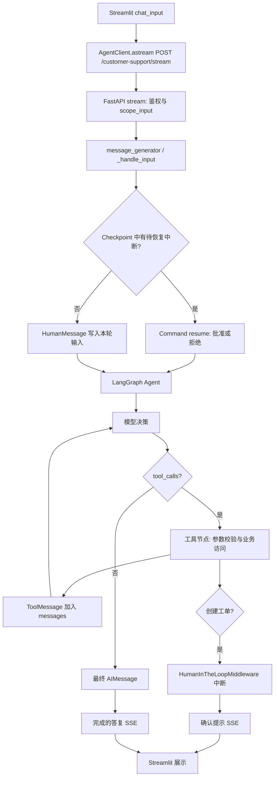

# Agent 执行链：从输入到 SSE

以下以默认 `customer-support` 的 `/stream` 请求为主；具体实现以列出的源码为准。

## 入口和初始化

1. `src/run_service.py` 用 Uvicorn 启动 `service:app`。`src/service/service.py:lifespan` 建立 Checkpoint/Store，遍历 `src/agents/agents.py:load_agent`，将 saver/store 绑定到每张图；默认客服加载失败会阻止启动。`CustomerSupportAgent.load()` 根据 `CUSTOMER_SUPPORT_MODE` 选择 Ollama、Qwen 或 Mock。
2. `src/streamlit_app.py:main` 维护 UI `thread_id` 和客户端会话令牌；`AgentClient.astream` 将消息、模型、`thread_id` 发往 FastAPI。客户端只传本轮文本，历史由服务端 Checkpoint 恢复。
3. `src/service/service.py:stream` 经 bearer 和 `session_identity` 检查后，`scope_input` 将公开 `thread_id` 与会话凭证、Agent ID 哈希组合成内部 Checkpoint key；请求参数本身不能授予访问他人会话的权限。

## 图内循环

`message_generator` 调用 `_handle_input`：先用 `agent.aget_state` 查看中断；若有待审批任务，使用 `Command(resume=...)`，否则构造 `{"messages": [HumanMessage(...)]}`。图的 `messages` 使用 LangGraph 消息累加语义，历史由相同内部 `thread_id` 的 Checkpoint 读回。

真实客服图在 `src/agents/customer_support_agent.py:build_customer_support_graph` 调用 LangChain `create_agent(model, tools, middleware, system_prompt)`。该工厂内部编译模型节点、工具节点及“有工具调用则执行工具并回到模型，否则结束”的条件路由；仓库没有为真实客服手写节点/边。注册工具是 `search_policy`、`get_order_status`、`check_refund_eligibility`、`create_support_ticket`（`src/customer_support/tools.py`）。模型生成结构化 `tool_calls`；工具执行结果形成 `ToolMessage`，再交回模型形成最终 `AIMessage`。Qwen 模式的 `deterministic_tool_routing` 仅在意图和参数明确时限制可选工具；Ollama 构图时 `force_routing=False`，由模型自行选工具。工具参数与实际业务结果不能仅凭模型答复判断。

用 `FakeToolModel` 实际编译本图并调用 `get_graph()`，观察到节点 `__start__ → log_agent_start.before_agent → model → HumanInTheLoopMiddleware.after_model`。该中间件节点有条件边通往 `tools`、`model` 或 `log_agent_end.after_agent → __end__`；`tools` 有返回 `model` 的条件边。`log_model_call`、`deterministic_tool_routing`、`log_tool_call` 是包裹调用的 middleware，不会全部单独显示为图节点。条件分支来自框架的 `create_agent`，不是本项目额外实现的路由函数。

`HumanInTheLoopMiddleware` 在 `create_support_ticket` 写入前中断；下一轮 `_handle_input` 根据 `src/service/service.py:_hitl_resume_value` 将明确确认映射为批准，其他答复拒绝。工具层还校验订单与手机号后四位，工单层有幂等键。图在没有待调用工具、模型给出最终答复时结束；审批中断会暂停而非执行写入。

## 输出、异常与超时

`message_generator` 对 Ollama 默认客服只遍历图 `updates`，过滤内部消息，最后发布完成的 AI 回复或确认提示；其他模式的通用 SSE 路径可发布 `updates/messages/custom` 及 token。`AgentClient.astream` 解析 SSE；Streamlit 的客服展示再次过滤工具消息和思考文本。`/invoke` 取最终 `values` 或优先取中断，`/history` 从 Checkpoint 读取并按会话隔离。

模型/工具异常记录类型而不写凭据；FastAPI 对外给通用错误。`src/streamlit_app.py:_await_with_wait_status` 对整次请求设默认 300 秒截止，超时取消客户端等待并恢复输入；模型端还有各 Provider 自己的超时。客户端取消不等于能撤销已经由服务端完成的写操作，写入依赖审批和幂等保障。

审计发现：`src/client/client.py:_parse_stream_line` 当前把 SSE `error` 包装成 `type="ai"` 的消息，而不是抛出 `AgentClientError`；因此流式失败可能被前端当作普通答复。这是后续应修的错误语义，不在本次只整理架构的范围内改动。

## Offline Mock 的不同执行路线

`src/agents/customer_support_mock.py` 定义 `CustomerSupportState(MessagesState)`，另加 `pending_query`、`pending_ticket`。图只有 `customer_support_node → END`，无模型工具循环：节点内用规则识别意图、直接调用政策/订单/退款/工单 Python 函数，返回消息和待办槽位。它依然接入同一个 FastAPI、Checkpoint、SSE 和会话隔离机制。
