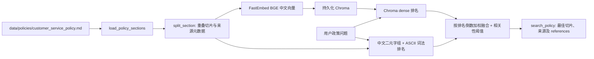

# 政策 RAG 架构

## 索引构建

`src/customer_support/policy.py:load_policy_sections` 按 `##` 标题解析 Markdown；`src/customer_support/rag.py:split_section` 将每节切成默认 220 字符、重叠 40 字符的 `Document`，元数据有 `chunk_id/title/source/chunk_index`。`FastEmbedChineseEmbeddings` 懒加载 `BAAI/bge-small-zh-v1.5`；`PolicyKnowledgeBase.ensure_index` 以源文和切片等计算指纹，变更后重建持久化的 `data/chroma/` 索引，模型缓存位于 `data/models/`。上述目录是本地运行数据，不应随清理删除。

## 检索、引用与拒答

`PolicyKnowledgeBase.search` 支持 `dense`、`lexical`、`hybrid`。向量路用 Chroma 相似度；词法路用中文二元字组/英文数字 token 的重叠率，**不是 BM25**。融合将两路排名按 `1/(10+rank)` 累加，词法路有权重调节，属于自定义倒数排名融合，不能直接称标准 BM25+RRF。混合路默认还用 dense 相关度或词法分数阈值过滤，最后返回 top-k 切片及分数、来源、排名。

`policy.py:search_policy` 取最多两条，返回最佳命中的 `title/content/source/score` 和 `references`；无结果返回“未检索到相关政策”及空引用。真实 Agent 的 Prompt 要求按工具原文标来源，Mock 直接拼接文件及章节。检索层只提供证据，最终表述由模型决定；现有代码未实现 Query Rewrite、独立重排器或多文档一致性检查。

## 验证入口

- `tests/customer_support/test_rag.py` 测切片/检索行为。
- `scripts/evaluate_rag.py` 用 `data/evaluation/rag_cases.json` 对比 lexical/dense/hybrid，计算 Hit@1、Hit@3、MRR@3、越界拒答率和延迟，写入必要报告 `data/evaluation/rag_report.json`。
- `scripts/create_chroma_db.py` 和 `docs/RAG_Assistant.md` 服务另一演示 Agent，不是默认客服政策索引的唯一入口；不要因名字相似直接删除。
