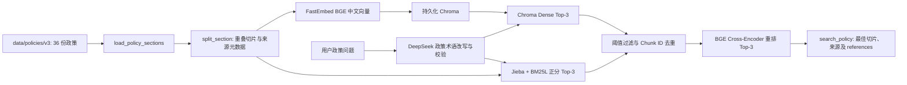

# 政策 RAG 架构

## 索引构建

默认服务读取 `data/policies/v3/` 的 36 份政策。`src/customer_support/policy.py:load_policy_sections` 按 `##` 标题解析 Markdown；`src/customer_support/rag.py:split_section` 将每节切成默认 220 字符、重叠 40 字符的 `Document`，并保留来源与可检索元数据。`FastEmbedChineseEmbeddings` 懒加载 `BAAI/bge-small-zh-v1.5`；`PolicyKnowledgeBase.ensure_index` 以源文和切片等计算指纹，变更后重建持久化的 `data/chroma/` 索引。重排器使用固定修订的 `BAAI/bge-reranker-base` ONNX 模型，缓存于 `data/models/bge-reranker-base/`；首次缺失权重时会下载。实验可通过成对的 `ORDERCARE_EVAL_POLICY_PATH`、`ORDERCARE_EVAL_CHROMA_PATH` 隔离语料与索引。

## 检索、引用与拒答

默认 `search_policy` 先以 DeepSeek 改写问题，使用与 v5 实验相同的政策术语 Prompt、JSON Schema 和实体、数字、否定校验；校验失败、API 失败或未配置 `DEEPSEEK_API_KEY` 时回退原问题。随后 Dense 与 BM25 各取最多 3 条，Dense 保留 0.50 相关性阈值，BM25 仅保留正分候选；按 Chunk ID 去重，用原始或有效改写 Query 与“标题 + 正文”组成配对，由本地 BGE Cross-Encoder 评分并返回 Top-3。模型及校验逻辑与 v5 重排实验共用。单独调用 `PolicyKnowledgeBase.search` 时仍可选择历史 `dense`、`lexical`、RRF `hybrid`，供实验对照使用。

`policy.py:search_policy` 取最多三条，返回最佳命中的 `title/content/source/score` 和 `references`；`score` 现在是 Cross-Encoder 原始分数。无结果返回“未检索到相关政策”及空引用。真实 Agent 的 Prompt 要求按工具原文标来源。检索层只提供证据，最终表述由模型决定。DeepSeek 改写会增加每次政策检索的 API Token 和延迟；无密钥时仍可执行原问题的本地混合重排。

## 验证入口

- `tests/customer_support/test_rag.py` 测切片/检索行为。
- `scripts/evaluate_rag.py` 使用冻结的 `data/evaluation/rag/dataset-v1.json`（40题），当前默认 Top-3；历史 Top-2 实验结果及专用复现实验脚本仍保留。生成与引用支持指标仅在显式启用 LLM Judge 后测量。详见 [评测框架](../evaluation/rag-evaluation.md) 与 [优化报告](../evaluation/rag-optimization-report.md)。
- 旧72题与 `rag_report.json` 作为历史结果保留。当前仅保留词法融合权重参数；旧二元字组的 0.30 阈值已移除。术语扩展仅用于实验，线上不启用。
- `scripts/create_chroma_db.py` 和 `docs/RAG_Assistant.md` 服务另一演示 Agent，不是默认客服政策索引的唯一入口；不要因名字相似直接删除。

## 生成评测（离线）

冻结检索结果可通过 `scripts/evaluate_rag_generation.py` 回放线上 Prompt 和工具结果，再用 `scripts/audit_rag_evidence.py` 独立诊断证据充分性。`--mode structured` 只用于实验，不修改线上策略。详见 [生成质量评测](../evaluation/rag-generation-evaluation.md)。
